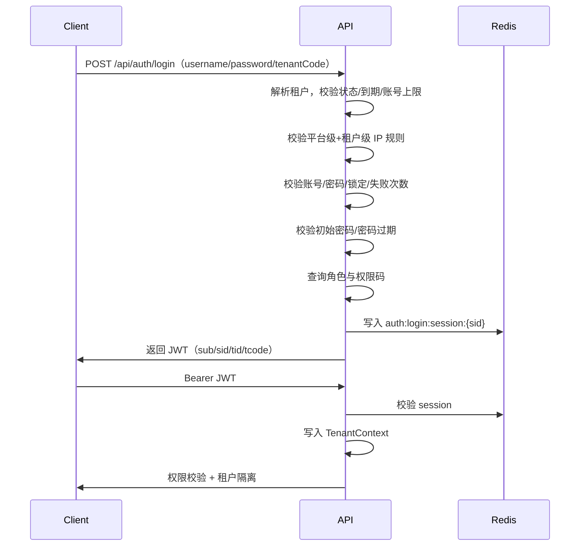

# 认证与权限架构

> 版本：V2.2 | 模块：auth-permission | 上游：[docs/README.md](../README.md)

## 概述

本篇定义认证与授权最终约束：Spring Security 6 + JWT + Redis + RBAC + Tenant Context，并明确平台/租户管理员边界与超级管理员绕过规则。

---

## 最终方案

**Spring Security 6 + JWT + Redis + RBAC + Tenant Context**

---

## 租户模型最终约束

> **一个账号只属于一个租户**

- `sys_user` 直接持有 `tenant_id`
- 不设计同一账号跨租户切换
- 不引入用户-租户多对多关系表

好处：认证简单、JWT 租户固定、权限缓存简单、数据隔离稳定。

---

## 平台级租户固定规则

```text
tenant_id = '0'
```

- 平台级数据一律 `tenant_id='0'`
- **不使用 `null` 表示平台级**
- 平台管理员账号归属平台租户
- 平台公共配置、公告、字典、IP 规则统一 `tenant_id='0'`

---

## 平台管理员与租户管理员边界

### 平台管理员（`tenant_id='0'`，`user_type='platform'`）

负责：租户管理（开通/启停）、平台级参数/公告/字典/IP 规则、菜单模板、平台审计与安全策略。

**租户开户（模型 A）**：创建租户时自动开通根部门、默认岗位、超级管理员角色与首个管理员账号；返回 `TenantProvisionVO` 供前端一次性展示登录信息。平台**不**代管该租户的用户/部门/岗位日常 CRUD；租户管理员登录后自管组织。

### 租户管理员

负责：本租户用户/角色/部门/岗位/参数/公告/IP 规则/业务数据。

限制：不能管理其他租户、不能修改平台级全局安全规则、不能越权访问平台管理域。

**登录约定（开户账号）**：企业租户用户名 `tenant_admin`；单位租户用户名 `org_admin`；密码为创建时的标准初始密码；`must_change_password=1`。
---

## 超级管理员绕过规则

### 平台超级管理员（`is_super_admin=1`）

- 可绕过租户级权限限制，可查看管理各租户资源
- **不能绕过**：显式禁用、账号封禁、平台级禁止 IP、密码失效、会话失效

### 租户超级管理员（`is_super_role=1` 或 `is_super_admin=1`）

- 可绕过本租户普通菜单权限校验
- **不能绕过**：平台级安全限制、其他租户数据、显式禁用、平台级禁止 IP
- **实现（V26+）**：`is_super_role=1` 的角色加载「全部 `assign_scope=TENANT` 的权限码」；路由同理

---

## 能力分级与角色模板（V26+）

### 平台专属 vs 租户可授权

| 分类 | 示例 permission_code | 授予对象 |
|------|---------------------|----------|
| 平台专属 | `tenant:tenant:*`、`system:i18n*:*`、`system:menu:*`、`system:dict:*`、`system:config:*`、`tool:ai:view`、`tool:ai:update` | 仅平台角色 |
| 租户可授权 | `tool:ai:query`、`tool:ai:generate`、`tool:ai:table`、`tool:ai:codegen`、`tool:gen:*` | 租户角色按套餐分配 |

**判定来源**：`sys_menu.assign_scope`（`PLATFORM` / `TENANT`），由平台管理员在「菜单管理」维护；服务层见 `MenuAssignScopeService`。

### 预置角色

| 角色 | role_code | tenant_id | is_super_role | 说明 |
|------|-----------|-----------|---------------|------|
| 平台超级管理员 | `platform_super_admin` | `0` | `1` | 全部菜单；`user.is_super_admin=1` 时 bypass 全部权限码 |
| 租户管理员 | `tenant_admin` | 业务租户 | `1` | 本租户全部能力，不含平台专属；可管理本租户用户/角色（应急上帝角色） |
| 系统管理员（三权） | `tenant_sys_admin` | 业务租户 | `0` | 组织/业务；不含 user/role/IP/租户策略与审计日志 |
| 安全管理员（三权） | `tenant_sec_admin` | 业务租户 | `0` | 用户/角色/IP/租户策略/在线踢人 |
| 审计管理员（三权） | `tenant_audit_admin` | 业务租户 | `0` | 登录/操作/接口日志只读（不含 clear） |
| 业务开发者 | `tenant_developer` | 业务租户 | `0` | 模板角色：工作台 + 代码生成 + AI 使用，不含系统管理 |

**三权互斥（SOD）**：同一用户不可同时绑定 `tenant_sys_admin` / `tenant_sec_admin` / `tenant_audit_admin` 中的任意两个及以上（`SodRoleGuard`）。新租户创建时由 `TenantRoleBootstrapService` 从 default 租户模板复制三权角色及菜单；同时由 `TenantBootstrapService` 创建根部门/岗位/超级角色与首个管理员（见上文开户约定）。
### MFA（TOTP）

- 租户策略：`security.mfa.enabled`、`security.mfa.force-admin`
- 口令成功且用户已绑定 MFA → 返回 `mfaTicket`（无 JWT）→ `POST /auth/mfa/verify`
- `force-admin` 命中（超管 / 超级角色 / 三权）且未绑定时 → 发 JWT + `mustEnrollMfa`，由 `ForceMfaEnrollFilter` 门禁
- 密钥：`sys_user.mfa_secret_enc`（AES-GCM，派生自 JWT secret）

### AI 模块权限码

| 权限码 | 平台 | 租户 | API 用途 |
|--------|:----:|:----:|----------|
| `tool:ai:view` | ✅ | ✅ | 进入 AI 能力目录等只读页 |
| `tool:ai:update` | ✅ | ✅ | 保存连接/模型/能力绑定、探测 |
| `tool:ai:query` | ✅ | ✅ | 读配置状态、审计日志、会话列表 |
| `tool:ai:generate` | ✅ | ✅ | 建表/代码生成/对话发送 |
| `tool:ai:table` | ✅ | ✅ | 智能建表菜单（F 按钮同码；C 页 permission_code 可为 null） |
| `tool:ai:codegen` | ✅ | ✅ | 代码助手菜单（F 按钮同码；C 页 permission_code 可为 null） |

AI 连接与 Key 存于 Catalog（`tool_ai_provider` 等），按能力绑定解析；平台可配默认，租户可采纳/覆盖。

> `sys_menu.permission_code` 有唯一约束 `(permission_code, deleted)`。C 页面与 F 按钮不可重复同一码；C 页路由靠 `sys_role_menu` 授权，API 鉴权走 F 按钮权限码。

### 新增业务模块授权规范

1. 在 `sys_menu` 增加 M/C/F 菜单与 `permission_code`，并设置 `assign_scope`（平台独占能力设为 `PLATFORM`）
2. Flyway：`sys_role_menu` 授平台角色；租户套餐用 `tenant_admin` / 模板角色 / 套餐 SQL
3. Controller 使用 `@PreAuthorize("@authz.hasPermission('module:action')")`
4. 前端 `v-hasPermi` 与菜单 `permission_code` 保持一致
5. **租户角色菜单授权**：前端走 `GET /system/role/{id}/assignable-menus`（`system:role:update`），按目标角色租户仅返回 `assign_scope=TENANT` 菜单；`RoleMenuService.assignMenus` 服务端二次校验。勿用 `GET /system/menu/page`（需 `system:menu:list`，平台专属）
6. **菜单模板 CRUD**：仅 `tenant_id=0` 可操作（`MenuAssignScopeService.assertPlatformMenuOperator`）
7. **代码生成**：`baseType=tenant` 的模块自动在 `ServiceImpl` / `Mapper.xml` 注入 `TenantQueryScope` 与 `tenant_id` 查询条件

---

## 数据层租户隔离（V29+）

菜单/权限控制「能否进入功能」；列表与详情还需按 `tenant_id` 过滤，避免租户管理员看到其他租户（含平台 `tenant_id=0`）的数据。

### 机制

| 层级 | 说明 |
|------|------|
| **MyBatis 租户插件** | 非 `ignore-tables` 的表自动追加 `tenant_id = 当前租户` |
| **`TenantQueryScope`** | 业务租户强制绑定查询 `tenantId`，禁止客户端 `?tenantId=` 越权；`getById` 后校验行归属 |
| **`@DataScope`** | 有归属列的业务表同行级范围（禁止审计列；区划不在行 L3） |
| **`assign_scope=PLATFORM`** | 菜单模板、全局字典参数、平台 i18n 等 — 租户无菜单/API 权限 |

### `ignore-tables` 注意

以下表**不走**租户插件，需服务层显式校验或仅平台可访问：

`sys_tenant`、`sys_menu`、`sys_i18n_*`、`gen_*`

`sys_login_log` 已移出 ignore 列表（V29），与操作日志、API 日志一致走插件 + `TenantQueryScope`。

### 各模块现状

| 模块 | 隔离方式 |
|------|----------|
| 用户/角色/部门/岗位/公告/参数 | 租户插件 |
| 登录/操作/API 访问日志 | 租户插件 + `TenantQueryScope` |
| AI 调用/DDL/对话记录 | 租户插件 + `TenantQueryScope.bindQueryTenantId` / `assertReadable` |
| 字典读取（下拉/标签） | 租户 + 平台 `tenant_id=0` 合并；`DictDataService` 用 `TenantScopeRunner` 绕过插件 |
| 字典/菜单/参数管理 | `assign_scope=PLATFORM` + 平台操作员校验 |
| 租户管理 | 仅平台菜单 |




### 详细步骤

1. 提交用户名、密码、租户编码
2. 解析租户编码，校验状态、到期、账号上限
3. 校验平台级和租户级 IP 规则
4. 校验账号状态、密码、登录失败次数、锁定状态
5. 校验是否要求修改初始密码、密码是否过期
6. 查询角色、菜单权限、按钮权限
7. 生成 `session_id`，写入 Redis
8. 生成 JWT 并返回
9. 后续请求：解析 JWT → 校验 Redis → 写入 `TenantContext` → 鉴权与隔离

---

## JWT 字段

```json
{
  "sub": "1912345678901234567",
  "sid": "c2c5e9c8e7f04e4dbf6f1b89aa8f1111",
  "tid": "1912345678901234001",
  "tcode": "tenant_a",
  "typ": "access",
  "iat": 1710000000,
  "exp": 1710007200
}
```

---

## Redis Key 设计

```text
auth:login:session:{sid}
auth:user:sessions:{tenantId}:{userId}
auth:perm:{tenantId}:{userId}
auth:blacklist:{tokenHash}
auth:login:fail:{tenantId}:{username}
tenant:config:{tenantId}
tenant:ip-rule:{tenantId}
dict:{tenantId}:{dictType}
```

| Key | 说明 |
|-----|------|
| `auth:login:fail:{tenantId}:{username}` | 登录失败计数（V2.1 新增） |
| `dict:{tenantId}:{dictType}` | 字典缓存（V2.1 新增） |

---

## 权限控制

```java
@PreAuthorize("@authz.hasPermission('system:user:list')")
```

详见 [15 菜单与权限](15-menu-permission.md)。

---

## 数据权限（冻结）

访问三层：**L1** 能力码 → **L2** 租户 → **L3** 行归属（`user_id`/`dept_id`）。区划仅租户级 `root_region_id`，不做行 L3。禁止 `created_by`/`updated_by` 作 L3。

### 新业务唯一接线

| 场景 | 固定写法 |
|------|----------|
| 写归属 | `OwnershipColumns.applyUser` / `applyUserAndDept`（空值失败） |
| 列表 | **Service 接口** `page` 上 `@DataScope` + Mapper `${dataScopeSql}` |
| 详情/改删 | `RowAccessSupport.assertReadable(tenantId, DataScopeSpec…, ownerUserId, ownerDeptId)` |

**禁止**：Controller / ServiceImpl 挂 `@DataScope`；配置表加 `${dataScopeSql}`；客户端传 `dataScopeSql`（框架已清空+禁绑）。

```java
// Service 接口
@DataScope(userColumn = "user_id", deptColumn = "dept_id")
PageResult<X> page(XPageQuery query);

OwnershipColumns.applyUserAndDept(entity::setUserId, entity::setDeptId, userId, ownerDeptLookup);

rowAccessSupport.assertReadable(
    entity.getTenantId(), DataScopeSpec.userAndDept(), entity.getUserId(), entity.getDeptId());
```

```xml
<if test="dataScopeSql != null and dataScopeSql != ''">${dataScopeSql}</if>
```

特例：`sys_user`→`userAsId()`；`sys_dept`→`deptAsId()`。  
白名单：站内信平台超管可 bypass L3（勿复制）。OA 收件箱按发起人；WF 读仍 WorkflowAccessGuard。

代码生成（`hasDataScope`）已按上表出接口注解 / XML / OwnershipColumns / assertReadable。详见 `.cursor/rules/row-access-l3.mdc`。

---

## 相关文档

- [13 多租户设计](13-multi-tenant.md)
- [15 菜单与权限](15-menu-permission.md)
- [14 IP 授权](14-ip-access-rule.md)
- [07 数据库规范](07-database-conventions.md)

---

## 落地检查清单（Checklist）

- [ ] 一用户仅属一个租户，无跨租户切换
- [ ] 平台级数据 `tenant_id='0'`，不用 null
- [ ] 平台管理员 `user_type='platform'`，`tenant_id='0'`
- [ ] 超级管理员绕过规则按文档实现，安全底线不可绕过
- [ ] `is_super_role=1` 租户角色 bypass 已实现（V26+）
- [ ] 平台专属菜单通过 `sys_menu.assign_scope=PLATFORM` 维护，新模块 Flyway 按分级授权
- [ ] 登录校验 IP、锁定、密码过期、强制改密
- [ ] JWT 含 `tid`/`tcode`，Redis 含失败计数 Key
- [ ] 权限校验基于权限码，非菜单存在性
