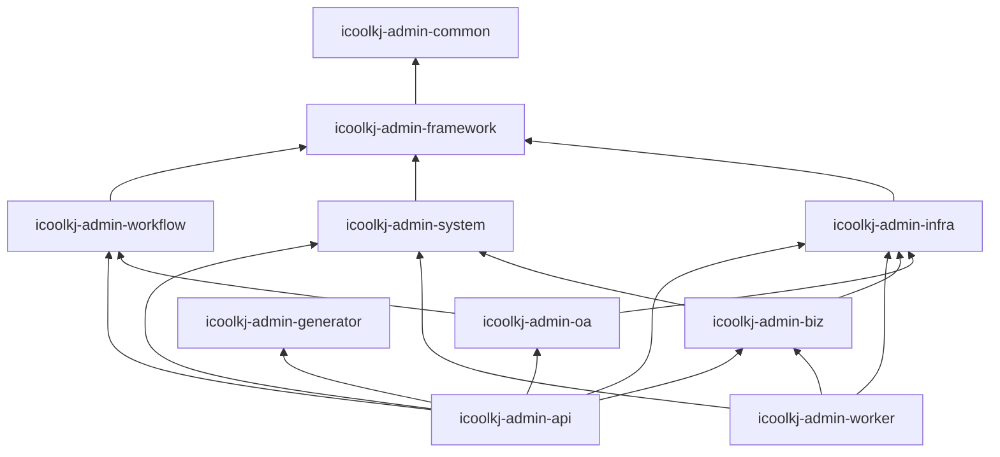

# 核心模块设计

> 版本：V2.2 | 模块：core-modules | 上游：[docs/README.md](../README.md)

## 概述

本篇列出平台三大模块域功能清单，含租户管理、IP 规则、菜单权限资源与安全字段。

---

## 系统模块（`icoolkj-admin-system`）

对应 API：`/api/system/*`、`/api/tenant/*`，前端：`views/system/`、`views/tenant/`

| 功能 | 说明 | 主要数据表 | 租户属性 |
|------|------|-----------|---------|
| **租户管理** | 租户创建（**企业/单位**）、状态、到期、账号上限、**服务根区划**、单位父子租户 | `sys_tenant`、`sys_region` | 平台全局 |
| 用户管理 | 账号、密码、状态、部门关联 | `sys_user` | 租户私有 |
| 角色管理 | 角色、数据范围、菜单授权、**区划数据权限** | `sys_role`、`sys_role_region` | 租户私有 |
| 菜单管理 | 目录、菜单、按钮权限 | `sys_menu` | 平台统一菜单 |
| **区划管理** | 国标区划树（平台 CRUD；租户只读 `tenant-tree`） | `sys_region` | 平台全局 |
| 部门管理 | 租户内组织架构（标准部门树） | `sys_dept` | 租户私有 |
| 岗位管理 | 岗位定义与用户关联 | `sys_post` | 租户私有 |
| 字典管理 | 字典类型与数据项 | `sys_dict_type`、`sys_dict_item` | 平台+租户 |
| 系统参数 | 可配置键值参数 | `sys_config` | 平台+租户 |
| 通知公告 | 系统通知与公告 | `sys_notice` | 平台+租户 |
| **IP 访问规则** | IP 白名单/黑名单 | `sys_ip_access_rule` | 平台+租户 |
| **定时任务** | 平台调度定义（`JobHandler` + DB 启停/cron） | `sys_job` | 平台运维 `tenant_id=0` |
| **任务执行日志** | Cron/手动执行记录（手动含触发人） | `sys_job_log` | 平台运维 |
| 登录日志 | 登录成功/失败记录 | `sys_login_log` | 租户私有 |
| 操作日志 | 用户操作审计 | `sys_operation_log` | 租户私有 |

---

## 基础设施模块（`icoolkj-admin-infra`）

对应 API：`/api/infra/*`，前端：`views/monitor/`、`views/tool/`

| 功能 | 说明 | 主要数据表 | 租户属性 |
|------|------|-----------|---------|
| 文件管理 | 上传、存储、访问 | `infra_file` | 租户私有 |
| 异步任务 | 任务状态跟踪（用户发起；管理端只读+终态删除）；AI/Excel 对接见 [34](34-platform-job.md)、[35](35-excel-export-import.md)、[37](37-ai-async-task.md) | `infra_async_task` | 租户私有 |
| 接口访问日志 | API 访问审计 | `infra_api_access_log` | 租户私有 |
| 第三方调用日志 | 外部服务调用记录 | `infra_thirdparty_call_log` | 租户私有 |

---

## 工作流模块（`icoolkj-admin-workflow`）

对应 API：`/api/workflow/*`（及 OA/业务侧启动入口）。契约见 [27](27-workflow-foundation-contracts.md)、[29](29-workflow-design-json-vs-bpmn.md)、[24](24-workflow-cross-tenant.md)。

| 功能 | 说明 | 主要数据表 |
|------|------|-----------|
| 流程定义 / 设计 | Design JSON SoT + BPMN 部署 | Flowable 表 + `wf_*` |
| 流程实例 / 任务 | 启动变量、审批、跨租户转发 | Flowable + `wf_biz_process` |
| 平台模板种子 | Flyway **V4** 通用办事模板 + icoolkj 样例 | migration V4 |

## OA 模块（`icoolkj-admin-oa`）

对应 API：`/api/oa/*`。字段配置 L0 见 [25](25-oa-form-field-editor.md)。

| 功能 | 说明 |
|------|------|
| 办事表单字段配置 | L0 已落地；L1+ 暂缓 |
| 办事实例 | 与 workflow 启动变量对接 |

## 代码生成（`icoolkj-admin-generator`）

对应 API：`/api/tool/gen/*`，前端 Gen CRUD（`GenCrudPage` / `i18n/gen`）。生成后端与前端脚手架，不承载运行时业务域数据。

## 业务模块（`icoolkj-admin-biz`）

对应 API：`/api/biz/*`，前端：`views/biz/`

由具体项目扩展，**所有业务表默认带 `tenant_id`**：

| 领域 | 示例表 | 表前缀 |
|------|--------|--------|
| 项目管理 | `pm_project` | `pm_` |
| 客户管理 | `crm_customer` | `crm_` |
| 知识库 | `kb_article` | `kb_` |
| 工单中心 | `wk_ticket` | `wk_` |

---

## 框架抽象边界（V2.2）

`icoolkj-admin-framework` 与 `icoolkj-admin-infra` 负责提供可替换的基础设施抽象，业务与系统模块仅依赖接口：

| 抽象接口 | 所属模块 | 默认实现 |
|---------|---------|---------|
| `TenantContext` | framework | ThreadLocal + JWT 解析 |
| `AuthService` | framework | Spring Security + Redis 会话 |
| `CacheService` | framework | Redis |
| `ConfigService` | system | `sys_config` + 租户回退 |
| `IpRuleService` | system | `sys_ip_access_rule` + 缓存 |
| `JobHandler` / `JobRunner` | framework + system | Worker 内 Handler 实现；定义/日志在 `sys_job*` |
| `FileStorageService` | infra | MinIO |
| `AsyncTaskBus` | infra | Redis Stream |
| `ThirdPartyProvider` | infra | 可配置 SPI |

> 国产化或云厂商切换时，优先替换 `infra`/`framework` 中的具体实现，不修改 `biz` 业务代码。详见 [17 国产化兼容设计](17-domestic-compatibility.md)。

---

## 模块依赖关系

---

## 相关文档

- 上一篇：[08 API 规范](08-api-conventions.md)
- 下一篇：[10 部署架构](10-deployment.md)
- 多租户：[13 多租户设计](13-multi-tenant.md)
- 菜单权限：[15 菜单与权限](15-menu-permission.md)
- 日志脱敏：[16 日志脱敏](16-log-desensitization.md)
- 数据库表：[backend/database/README.md](../../backend/database/README.md)

---

## 落地检查清单（Checklist）

- [ ] 租户管理接口路径 `/api/tenant/*`
- [ ] 系统管理功能在 `icoolkj-admin-system`
- [ ] `sys_menu` 为平台菜单模板，含 M/C/F 资源
- [ ] 用户表含 `is_super_admin`、锁定与改密字段
- [ ] 基础设施表查询自动附加 `tenant_id`
- [ ] 业务功能仅放在 `icoolkj-admin-biz`
- [ ] 平台模块不引用 `biz` 模块任何类
