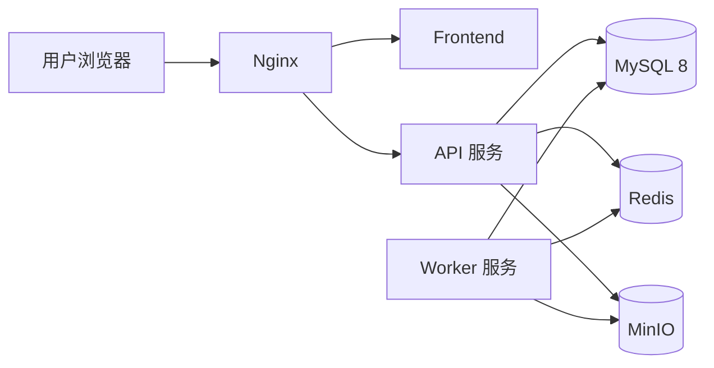

# 部署架构

> 版本：V2.2 | 模块：deployment | 上游：[docs/README.md](../README.md)

## 概述

本篇定义标准部署目录结构、部署组件及环境配置约定，确保各环境部署方式一致。

---

## 部署目录

```text
deploy/
  docker/
    backend.Dockerfile
    worker.Dockerfile
    frontend.Dockerfile
  compose/
    docker-compose.yml
  nginx/
    icoolkj.conf
  env/
    .env.example
```

| 路径 | 说明 |
|------|------|
| `deploy/docker/` | 各服务 Dockerfile |
| `deploy/compose/` | Docker Compose 编排文件 |
| `deploy/nginx/` | Nginx 反向代理配置 |
| `deploy/env/` | 环境变量模板（`.env.example`） |

---

## 标准部署组件



| 组件 | 职责 |
|------|------|
| Nginx | 反向代理、HTTPS 终结、静态资源、API 转发 |
| Frontend | Vue 3 构建产物，静态文件服务 |
| API | `icoolkj-admin-api`，HTTP 接口服务 |
| Worker | `icoolkj-admin-worker`，异步任务与定时任务 |
| MySQL | 主数据库 |
| Redis | 缓存、会话、消息队列 |
| MinIO | 对象存储 |

---

## 网络与端口建议

| 服务 | 内部端口 | 说明 |
|------|---------|------|
| Nginx | 80 / 443 | 对外入口 |
| Frontend | 内部 | 由 Nginx 代理 |
| API | 8080 | 由 Nginx 转发 `/api/` |
| Worker | — | 无 HTTP 端口 |
| MySQL | 3306 | 仅内网 |
| Redis | 6379 | 仅内网 |
| MinIO | 9000 | 仅内网 |

---

## 环境变量（`.env.example` 建议项）

```text
# 数据库
MYSQL_HOST=mysql
MYSQL_PORT=3306
MYSQL_DATABASE=icoolkj
MYSQL_USER=icoolkj
MYSQL_PASSWORD=

# Redis
REDIS_HOST=redis
REDIS_PORT=6379
REDIS_PASSWORD=

# MinIO
MINIO_ENDPOINT=http://minio:9000
MINIO_ACCESS_KEY=
MINIO_SECRET_KEY=
MINIO_BUCKET=icoolkj

# JWT
JWT_SECRET=
JWT_EXPIRE_SECONDS=7200

# 应用
SPRING_PROFILES_ACTIVE=prod
```

---

## 国产化部署兼容（V2.2）

后期可能部署于银河麒麟、统信 UOS、openEuler 等国产操作系统，以及鲲鹏、飞腾、龙芯等 CPU 架构。

| 约束 | 说明 |
|------|------|
| 容器优先 | 优先 Docker 部署，降低 OS/CPU 差异 |
| 无架构绑定二进制 | 禁止依赖特定 CPU 的 `.so` / `.dll` |
| JDK | 支持 OpenJDK 17 及国产 JDK 发行版 |
| 标准化 | JVM 参数、时区（Asia/Shanghai）、字符集（UTF-8）、路径分隔统一 |

详见 [17 国产化兼容设计](17-domestic-compatibility.md)。

---

## 相关文档

- 上一篇：[09 核心模块](09-core-modules.md)
- 下一篇：[11 初始化建议](11-initialization.md)
- 技术栈：[02 技术栈](02-tech-stack.md)
- 目录结构：[04 目录结构](04-directory-structure.md)

---

## 落地检查清单（Checklist）

- [ ] `deploy/` 目录包含 Docker、Compose、Nginx、env 四类配置
- [ ] 生产环境 API 与 Worker 分离部署
- [ ] MySQL、Redis、MinIO 不对外暴露公网端口
- [ ] `.env.example` 提供完整环境变量模板，不含真实密钥
- [ ] Nginx 配置 `/api/` 转发至 API 服务，`/` 转发至 Frontend
- [ ] Docker 镜像基于多阶段构建，减小镜像体积
