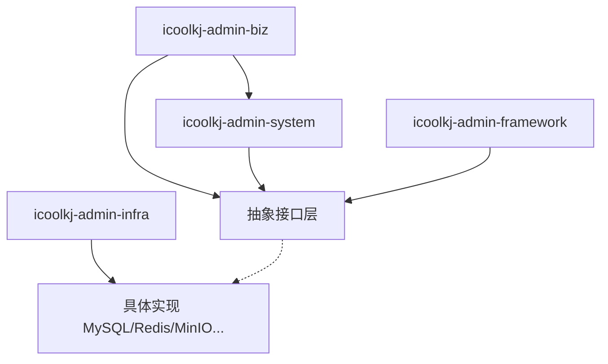

# 国产化兼容设计

> 版本：V2.2 | 模块：domestic-compatibility | 上游：[docs/README.md](../README.md)

## 概述

本篇定义 iCoolKJ Platform 后期国产化迁移的兼容策略与抽象边界。当前默认技术栈用于快速落地，架构必须从第一版开始控制中间件耦合，使国产化以**替换实现**为主，而非推翻业务层重做。

---

## 总体判断

| 层面 | 结论 |
|------|------|
| 业务架构 | 支持后期国产化 |
| 表结构与权限模型 | 迁移基础较好 |
| 中间件实现 | 必须增加抽象边界 |
| 深度绑定 MySQL/Redis/MinIO | 后期将产生系统性返工 |

---

## 兼容目标

### 国产数据库

达梦 DM、KingbaseES、openGauss、GaussDB、OceanBase、TiDB

### 国产操作系统

银河麒麟、统信 UOS、openEuler

### 国产 CPU 架构

鲲鹏、飞腾、龙芯等

### 国产第三方能力

对象存储、消息队列、短信、邮件、电子签章、OCR 等

---

## 数据库兼容策略

1. 优先使用 ANSI SQL 能力
2. 避免深度依赖 MySQL 专属函数
3. 复杂 SQL 集中在 Mapper XML 或 repository 层
4. 分页、时间函数、批量插入、字符串处理预留方言适配点
5. Flyway 脚本预留按数据库类型拆分能力
6. 禁止在业务层拼接数据库方言 SQL

### 特别注意

| 项 | 风险点 |
|----|--------|
| `datetime(3)` | 精度语法差异 |
| `on update current_timestamp(3)` | 自动更新语法差异 |
| 唯一索引与 `NULL` | 各库行为可能不同 |
| 保留字 | 需方言映射 |
| 分页 | `LIMIT` vs 其他语法 |
| JSON | 能力差异 |

详见 [07 数据库规范](07-database-conventions.md)。

---

## 缓存兼容策略

Redis 保留，但控制使用方式：

1. 仅承载缓存、会话、计数器、黑名单、轻量消息
2. 禁止业务核心闭环强绑定 Redis 特殊数据结构
3. 缓存 key、TTL、序列化格式统一规范
4. 缓存失效与重建逻辑在服务层可控

> `Redis Stream` 仅作默认异步实现，不应成为唯一任务总线抽象。

---

## 异步任务兼容策略

必须抽象为统一总线接口：

| 接口 | 职责 |
|------|------|
| `AsyncTaskPublisher` | 发布任务 |
| `AsyncTaskConsumer` | 消费任务 |
| `AsyncTaskScheduler` | 调度 |
| `AsyncTaskExecutor` | 执行 |

**默认实现：** Redis Stream

**可替换为：** RocketMQ、Kafka、RabbitMQ、国产消息队列

约束：业务模块禁止直接依赖 Redis Stream API；幂等、重试、死信在框架层实现。

---

## 文件存储兼容策略

禁止业务模块直接依赖 MinIO SDK，统一通过接口访问：

| 接口/模型 | 说明 |
|-----------|------|
| `FileStorageService` | 上传、删除、存在性检查 |
| `FileUploadRequest` | 上传请求 |
| `FileUploadResult` | 上传结果 |
| `FileDownloadUrlService` | 预签名/下载 URL |

**可切换实现：** MinIO、阿里云 OSS、腾讯 COS、华为 OBS、国产政企云对象存储、本地文件系统

---

## 第三方能力兼容策略

以下能力统一 Provider/SPI 化：

- 短信、邮件、OCR、电子签章、支付、地图、文档转换、推送通知

约束：

1. 业务层禁止直接依赖具体厂商 SDK
2. 渠道选择由配置层与基础设施层控制
3. 日志、超时、重试、熔断统一在基础设施层治理

---

## 部署与运行环境兼容策略

兼容目标：银河麒麟、统信 UOS、openEuler、鲲鹏/飞腾/龙芯、OpenJDK/国产 JDK

部署约束：

1. 优先容器化部署（Docker）
2. 禁止依赖特定 CPU 架构私有二进制
3. 禁止业务核心强依赖本地 `.so` / `.dll`
4. 图像处理、OCR、文档转换等须评估架构兼容性
5. JVM 参数、时区、字符集、文件路径标准化

详见 [10 部署架构](10-deployment.md)。

---

## 必须抽象的边界（第一版起）

| 抽象接口 | 说明 |
|---------|------|
| `TenantContext` | 租户上下文 |
| `AuthService` | 认证授权 |
| `CacheService` | 缓存 |
| `FileStorageService` | 文件存储 |
| `AsyncTaskBus` | 异步任务总线 |
| `ThirdPartyProvider` | 第三方能力 |
| `ConfigService` | 配置读取（含租户回退） |
| `IpRuleService` | IP 规则校验 |

原则：

- 业务代码依赖抽象接口
- 框架与 `infra` 模块依赖具体实现
- 国产化迁移时替换实现，不推翻业务层

---

## 相关文档

- [03 架构原则](03-principles.md)
- [02 技术栈](02-tech-stack.md)
- [09 核心模块](09-core-modules.md)
- [docs/README.md](../README.md) · [AI-CONTEXT.md](../AI-CONTEXT.md)
- [07 数据库规范](07-database-conventions.md)

---

## 落地检查清单（Checklist）

- [ ] 业务模块不直接 import MinIO/Redis Stream/厂商 SDK
- [ ] 复杂 SQL 仅在 Mapper XML，无业务层方言拼接
- [ ] `FileStorageService`、`AsyncTaskBus` 等接口已定义
- [ ] Flyway 目录结构支持按库类型扩展
- [ ] 部署采用容器化，无架构相关原生二进制依赖
- [ ] 第三方调用走 `ThirdPartyProvider` 并记录 `infra_thirdparty_call_log`
