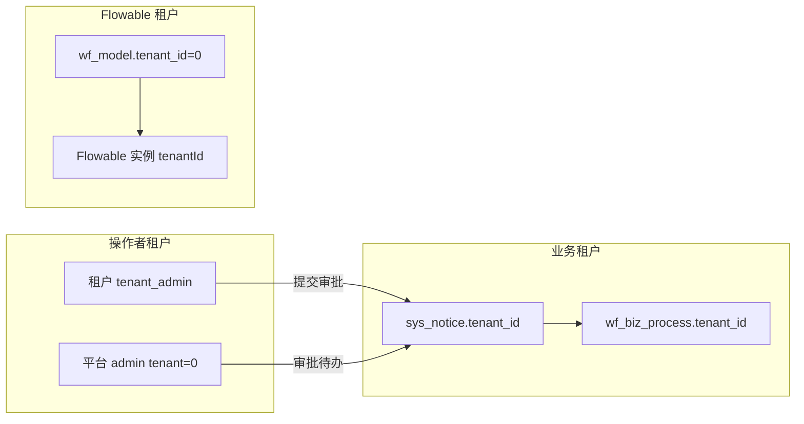

# 工作流跨租户规范

> 配套：[13 多租户](13-multi-tenant.md) · [gen-spec/drafts/workflow/CONFIGURATION.md](../../gen-spec/drafts/workflow/CONFIGURATION.md)

工作流场景下存在**三个独立的租户维度**，混用会导致「流程找不到」「业务不存在」「越权访问」等问题。本文是平台统一规范，新业务接入须遵守。

---

## 1. 三层租户模型

| 维度 | 来源 | 典型值 | 用途 |
|------|------|--------|------|
| **操作者租户** | 登录用户 `sys_user.tenant_id` / `TenantContextHolder` | 平台管理员 `0`；租户用户为业务租户 ID | MyBatis 默认行过滤、菜单/权限边界 |
| **业务租户** | 业务表 `tenant_id`、流程变量 `tenantId`、`wf_biz_process.tenant_id` | 公告所属租户 `1000000000000000001` | 业务数据归属、审批人 `resolve_scope=biz_tenant` |
| **Flowable 租户** | `wf_model.tenant_id` | `platform_mandatory` 模型为 `0` | 流程定义部署、实例 `tenantId` |



### 1.1 `platform_mandatory` 典型链路（公告）

- BPMN / `wf_model` 归属**平台**（`tenant_id=0`）→ Flowable 部署与启动用 `0`
- 公告行归属**租户** → `startProcess` 请求里 `tenantId` = 公告 `tenant_id`
- 平台管理员登录操作者租户为 `0` → 直接 `selectById` 查不到租户公告 → **须跨租户读 + 流程权限校验**

---

## 2. 引擎层统一组件（L2）

| 组件 | 职责 |
|------|------|
| `WorkflowTenantSupport` | 区分操作者 / 模型 / Flowable 租户 ID |
| `FlowableProcessDeployService` | 部署与启动使用 **模型归属** `tenant_id`；兼容无 tenant 历史部署 |
| `WorkflowBizProcessLookup` | 跨租户加载 `wf_biz_process`（表在 `ignore-tables`） |
| `WorkflowAccessGuard` | 流程查看/撤回：发起人、当前/历史 assignee |
| `WorkflowCrossTenantSupport` | **审批详情统一入口**：`runIgnoringBizTenant` + `assertCanApproveDetail` |
| `AbstractWorkflowBizHandler` | 终态回调统一跨租户读写业务表 |

### 2.1 启动流程

```java
// 业务租户 → 变量 tenantId + wf_biz_process.tenant_id
String bizTenantId = entity.getTenantId();
// Flowable tenantId → wf_model.tenant_id（platform_mandatory 为 0）
String flowableTenantId = processDeployService.resolveFlowableTenantId(
        model.getModelKey(), model.getTenantId());
```

**禁止**用操作者租户或业务租户直接作为 Flowable `tenantId`（除非 `wf_model.tenant_id` 与之一致）。

### 2.2 审批详情 `GET /.../approve-detail`

标准模板：

```java
Entity entity = workflowCrossTenantSupport.runIgnoringBizTenant(() -> mapper.selectById(id));
workflowCrossTenantSupport.assertCanApproveDetail(entity.getProcessInstanceId(), entity.getId());
```

### 2.3 流程终态 `WorkflowBizHandler`

继承 `AbstractWorkflowBizHandler`，使用 `requireBiz` / `updateBizIgnoringTenant`，**不要**在 handler 内散落 `TenantScopeRunner`。

---

## 3. 数据访问策略

### 3.1 `ignore-tables`

`wf_biz_process` 已加入 `application-icoolkj-shared.yml` 的 `ignore-tables`：

- 行内自带 `tenant_id`（业务租户）
- 查询须配合 `WorkflowAccessGuard` 或业务侧显式权限，**不能**因 ignore 而裸查

其余 `wf_*` 表（`wf_model`、`wf_approver_rule` 等）仍走租户行过滤，由 `WorkflowTenantSupport.modelOwnerTenantId()` 约束写操作。

### 3.2 何时 `runIgnoringBizTenant`

| 场景 | 需要？ |
|------|--------|
| 租户用户 CRUD 本租户业务 | 否（默认行过滤） |
| 平台/他租户用户通过流程访问业务行 | **是** |
| `WorkflowBizHandler` 回调更新业务状态 | **是** |
| 待办列表 / 实例详情（经 `wf_biz_process`） | 已由 `WorkflowBizProcessLookup` 处理 |

---

## 4. 新业务接入检查表（跨租户）

在 [CONFIGURATION.md §6](../../gen-spec/drafts/workflow/CONFIGURATION.md) 基础上追加：

```markdown
### 跨租户（L2 规范）
- [ ] submitApprove：`startRequest.setTenantId(业务行.tenant_id)`
- [ ] approve-detail：WorkflowCrossTenantSupport（勿手写 TenantScopeRunner + Guard）
- [ ] BizHandler：extends AbstractWorkflowBizHandler
- [ ] platform_mandatory：wf_model.tenant_id=0，勿用业务租户部署 BPMN
- [ ] 附件/封面：审批页用 `AuthImage` + `download-scope=notice`；后端 `assertNoticeFileAccessible` 须支持 `workflow:approve:*` 流程参与人（见公告实现）
```

---

## 5. 常见错误与症状

| 错误做法 | 症状 |
|----------|------|
| 用业务租户启动 Flowable | `Process definition ... tenantId '1000...' was not found` |
| 平台审批人直接 `mapper.selectById` | `公告不存在` / `entity not found` |
| 仅 ignore 表、无 AccessGuard | 潜在越权读他租户流程关联数据 |
| BizHandler 未 ignore 租户 | 终态回调更新 0 行，业务状态不同步 |

---

## 6. 参考实现

| 用途 | 路径 |
|------|------|
| 跨租户支持 | `workflow/support/WorkflowCrossTenantSupport.java` |
| Handler 基类 | `workflow/support/AbstractWorkflowBizHandler.java` |
| 公告审批详情 | `system/notice/service/impl/NoticeServiceImpl#getApproveDetail` |
| 公告终态回调 | `system/notice/workflow/NoticeWorkflowBizHandler` |
| Flowable 租户解析 | `workflow/engine/FlowableProcessDeployService` |

---

## 7. 与多租户文档关系

- [13-multi-tenant.md](13-multi-tenant.md)：全局租户插件、`ignore-tables` 原则
- 本文：**工作流专用**三层语义与 L2/L3 接入约束，冲突时以本文 + `CONFIGURATION.md` 为准
- 菜单分层与 OA / 公告型选型：[31-workflow-biz-menu.md](31-workflow-biz-menu.md)
