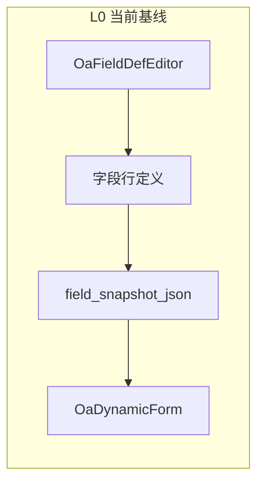
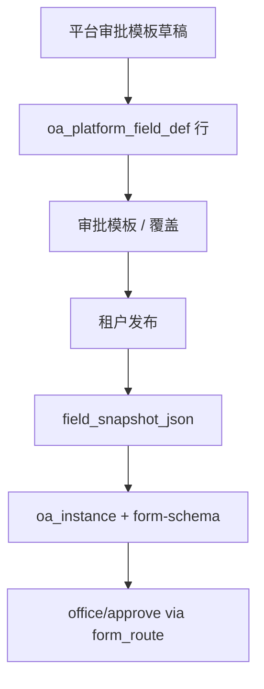

# OA 表单字段配置（非可视化设计器）

> 版本：V2.3 | 决策日期：2026-07-14 | 配套：[24 工作流跨租户](24-workflow-cross-tenant.md)  
> V2.3：接通 `field_type=richText` → `oa_instance_data.content_text` 存储契约

## 决策（定稿）

**现阶段维持 L0：表格型字段元数据编辑器 + 纵向动态表单运行时。**  
不引入可视化拖拽表单设计器作为唯一/主入口；L1（轻体验）及以后仅在出现明确业务信号时再立项。

| 层级 | 含义 | 状态 |
|------|------|------|
| **L0** | `OaFieldDefEditor` 表格配字段；`OaDynamicForm` 按 `sortNo` 纵向渲染 | **当前基线** |
| L1 | 排序拖拽、可选分组 / 简易双列（`group` / `colSpan`） | **暂缓** |
| L2 | 画布编排，组件只能挂已有 `fieldCode`；字段行仍为权威 | 见 [36-form-designer-sdk.md](36-form-designer-sdk.md) V1.1：Sandbox 壳 + OA-Bound 布局；**沙箱 ≠ 生产** |
| L3 | 完整设计器（布局树、样式事件、子表等） | 未启动 |

**对外话术**：称「表单字段配置 / 字段元数据编辑器」，不称「表单设计器」，避免与 WYSIWYG 画布对标产生预期落差。

---

## 与可视化表单设计器的关系

二者同属「低代码表单定义」产品族，但层级不同：

| 维度 | 本平台「配置字段」（L0） | 典型可视化「表单设计」 |
|------|------------------------|------------------------|
| 交互 | 表格增删改行 | 组件库 + 画布 + 属性面板 |
| 重心 | **数据契约**：编码、类型、字典、必填、索引槽、列表同步、平台锁定 | **呈现契约**：栅格、卡片、标签宽、样式、事件 |
| 产物 | `OaFieldDefVO[]`（行式 schema） | 树形 UI / layout schema |
| 运行时 | `OaDynamicForm` 纵向列表 | 按组件树还原设计态 |

L0 更贴合多租户 OA + 通用实例：校验与字典、槽位与列表、`platformLocked` / 版本发布、统一审批壳（`form_route` → `/office/approve`）均依赖**字段行**而非画布布局。

---

## 实现锚点

| 角色 | 路径 |
|------|------|
| 字段表格编辑器 | `frontend/src/views/oa/components/OaFieldDefEditor.vue` |
| 平台 / 租户入口 | `frontend/src/views/oa/platform-template/`、`tenant-template/` |
| 动态表单运行时 | `frontend/src/views/oa/components/OaDynamicForm.vue` |
| 通用发起弹窗 | `frontend/src/views/oa/components/OaInstanceFormDialog.vue` |
| 通用审批页 | `frontend/src/views/office/approve/index.vue` |
| 实例 API | `/oa/instance`（权限 `oa:instance:*`） |
| 租户发布快照 | `OaTenantTemplateVersionSupport` → `field_snapshot_json` |
| 字段 VO | `OaFieldDefVO` / `OaFieldDefItemRequest` |

### 主链路

- 模板绑定 `wfModelId`；审批页壳由 `wf_model.form_route` 决定，**不存**字段 schema。
- 字段语言：主文案用模板 `fieldName`；个别类别（如 `oa_leave`）可保留少量前端 gen i18n 兜底。

---

## 为何暂不上可视化设计器

1. **索引槽 / 列表同步**、**平台锁定** 在表格编辑器中可控；画布设计器通常后补且易失控。
2. 统一 `oa:instance` + 通用审批已落地，主线门槛是「可配字段并跑通流程」，不是栅格双列观感。
3. 引入成熟设计器（fc-designer / form-create / vform 等）需扩展 `layout_json`、重写运行时、扩组件库，并与 publish/snapshot/租户锁反复磨合——季度量级投入。
4. **禁止**用可视化设计器替换表格作为唯一入口，以免削弱数据契约与平台治理。

若未来上画布（L2+），**单一真相源**仍为字段行：`OaFieldDefVO` 权威；画布只编排已有 `fieldCode`。

---

## 实例存储分层（定稿）

| 层 | 落点 | 用途 |
|----|------|------|
| 短字段提升 | `idx_str_01…100`（01–10 可 list 冗余到主表） | 列表 / 检索 / 条件 |
| 全量表单 | `oa_instance_data.form_data` JSON | 除富文本正文外的字段值 |
| 长文正文 | `oa_instance_data.content_text` | **唯一** `field_type=richText` 的 HTML |

契约要点：

1. API / 前端始终用 `formData[fieldCode]`；持久化由 `OaFormContentTextSupport.split/mergeInto` 拆合，对调用方透明。
2. `richText` **禁止** `promote_slot` / `list_slot_sync`（校验：`error.oa.rich_text_no_slot`）。
3. 每模板最多一个富文本字段（`error.oa.rich_text_one_per_template`），对应单列 `content_text`。
4. 附件仍用 `form_data` 存 fileId + `infra_file_ref`；富文本不进流程条件变量。
5. 渲染：`componentType=richText` → `mapFormComponent` → Gen `rich-editor`（`RichTextEditor`）。
6. 富文本内嵌图：OA 宿主注入 `fileBizType=oa_instance` + `fileDownloadScope=infra`（勿用公告 `notice_richtext` / `notice` 通道）。
7. 发起表单未落库前，`oa_instance` 附件仅上传人可见（`OaInstanceFileVisibilityChecker`）；富文本插入图用 `fileId` 拼下载 URL，不依赖响应里可能为空的 `fileUrl`。

实现锚点：`OaFormContentTextSupport`、`OaInstanceServiceImpl.saveDataAndPromote`、`OaInstanceConvert.toVo`、`OaApproveFormHandler`、`OaFieldDefValidator`、`OaFormLayoutRuntime` host、`OaInstanceFileVisibilityChecker`。

---

## L1 启动条件（暂缓细则）

仅当同时满足时再单独立项（勿与本决策混做）：

- 业务大量需要分组、双列或选人/子表等，且不愿接受纯纵向列表；或
- 配置侧明确反馈「不像表单」且 L0 话术无法消化预期。

L1 建议范围（届时另开实现计划）：

- 编辑器：`sortNo` 拖拽排序；可选 `group` / `colSpan`（尽量不改主表，可放扩展字段或轻量 JSON）
- 运行时：`OaDynamicForm` 识别分组与简易列宽
- **不做**：完整组件库画布、样式/事件面板、第三方设计器整包替换

---

## 相关权限与菜单（摘要）

| 项 | 值 |
|----|-----|
| 实例权限 | `oa:instance:list/query/add/update/delete/submit/close` |
| 审批查看 | `workflow:approve:oa:view`（隐藏菜单 `OfficeApprove`） |
| 审批路由 | `/office/approve`（`wf_model.form_route`，勿带尾部 `/index`） |
