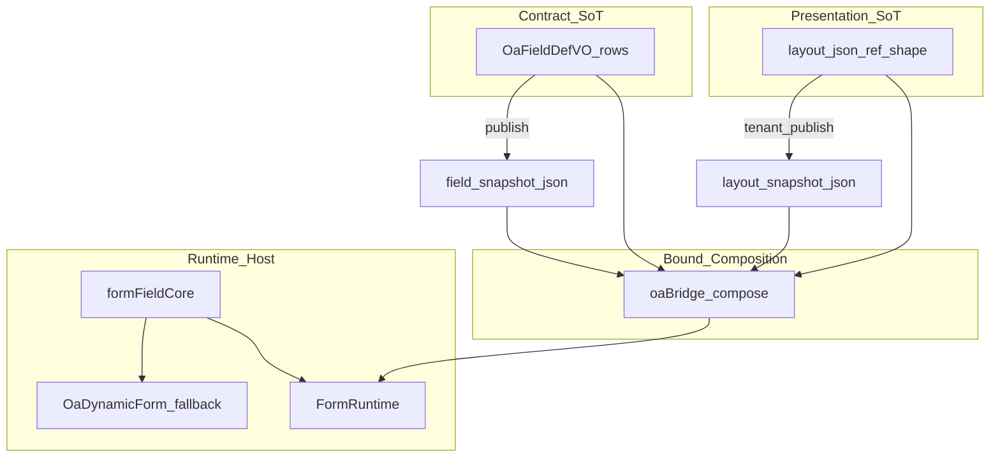

# 通用表单设计器 SDK（L2 底座）

> 版本：V1.3.1 | 2026-07-25 | 上游：[25-oa-form-field-editor.md](25-oa-form-field-editor.md) · [27-workflow-foundation-contracts.md](27-workflow-foundation-contracts.md)

## 1. 目标与边界

| 做 | 不做 |
|----|------|
| 管理端可嵌入的 **Form Designer SDK** | 面向办事用户的自助建表 |
| 多端预览（PC / 平板 / 手机） | 三端原生 App（后期接同一 Schema） |
| 稳定 `FormDocument` / 引用形 `layout_json` | 与 Flowable / Gen 代码生成耦合 |
| **OA-Bound** 布局编排 + 发布快照 | 用画布替换 L0 字段表格（槽位/锁定） |

**三套设计器独立：**

```text
Form Designer SDK  →  layout（呈现）+ fields（契约）
Workflow Designer  →  Design JSON / BPMN（流程）
Gen / page-spec    →  CRUD 页 view.json（列表页）
```

宿主配置（`dialog | drawer | page`）属于**页面壳**，不进表单画布组件库。

**话术：** 沙箱称「表单设计器（预览）」；OA 内称「表单布局设计（受控）」。沙箱壳 ≠ 生产设计器。

---

## 1.1 双模式（产品模型）

| 模式 | 用途 | 字段权威 | 画布权限 |
|------|------|----------|----------|
| **Sandbox** | `/tool/form-designer` | 文档内自洽 | 可增删改字段与布局 |
| **OA-Bound** | 平台/租户模板「布局」Tab | `OaFieldDefVO[]` 行表 | 只编排已有 `fieldCode`；锁定不可删 |



**持久化分层：**

| 对象 | 列 | 说明 |
|------|-----|------|
| 平台模板版本 | `layout_json` | **草稿**呈现（无独立 layout_snapshot） |
| 租户模板版本 | `layout_json` + `layout_snapshot_json` | 发布时草稿 → 快照 |
| 实例 data | `layout_snapshot_json` | 发起时从租户版本带入 |

---

## 1.2 硬规范

1. 三套设计器独立；不合并 Schema  
2. 字段行 SoT：layout **不承载**类型 / 字典 / 槽位 / 锁定 / 必填权威  
3. 不下发任意 JS（事件脚本 / 全局 CSS / 生成 SFC）  
4. 弹窗/抽屉 = 宿主壳，不进控件库  
5. 有 layout → **唯一**走 `FormRuntime`；无 layout → `OaDynamicForm` 回落；二者共享 `formFieldCore`  
6. 控件白名单对齐 `OaFieldDefVO.componentType` + `GenFormField`  
   - 基础：`input` / `textarea` / `richText` / `number` / `select` / `radio` / `checkbox` / `date` / `datetime` / `dateRange` / `switch` / `file`  
   - 组织：`user` / `dept`（`fieldType=ref`；值 `[{id,name}]`）  
   - 区间：`dateRange`（值 `[start,end]`，`YYYY-MM-DD`）  
7. Bound 合成永远使用**全量**字段池；`fieldPerm` 仅运行态注入  
8. Bound 保存必须经 Save Gate（`prepareBoundLayoutSave` / 服务端 `OaLayoutJsonValidator`）  
9. **file 进 Runtime 全链路**：有 layout 时附件在 `FormRuntime` 渲染；无 layout 才回落附件面板  
10. 业务宿主必须经 `buildBoundRuntimeDocument` 合成；禁止可写子集 / 去 file 后的 pool

---

## A. 四层模型

| 层 | 职责 | 代码锚点 |
|----|------|----------|
| **Contract** | 字段契约 SoT | L0 `OaFieldDefVO[]` / `field_snapshot_json` |
| **Presentation** | 布局呈现 SoT | `layout_json` / `layout_snapshot_json`（引用形） |
| **Bridge** | Bound 唯一合成 | `oaBridge.composeBoundDocument` / `persistLayout` |
| **Runtime Host** | 办事渲染 | `FormRuntime`（有 layout）/ `OaDynamicForm`（回落） |
| **Designer Host** | 设计编排 | `FormDesigner`（`hostMode=sandbox\|bound`） |

---

## B. Layout Persistence Contract（presentationVersion 2）

落库 JSON 为**呈现引用形**。`schemaVersion` = 文档结构；`presentationVersion` = 栅格契约。

```json
{
  "schemaVersion": 1,
  "presentationVersion": 2,
  "form": {
    "labelWidth": 100,
    "labelPosition": "left",
    "size": "default",
    "labelAlign": "right"
  },
  "nodes": [
    { "type": "divider", "id": "n1", "title": "基本信息" },
    { "type": "field", "id": "n2", "fieldCode": "title", "span": 24, "placeholder": "…" },
    {
      "type": "card",
      "id": "n3",
      "title": "明细",
      "children": [
        { "fieldCode": "amount", "span": 8 },
        { "fieldCode": "applyDate", "span": 8 }
      ]
    },
    {
      "type": "row",
      "id": "n4",
      "children": [
        { "fieldCode": "reason", "span": 16 },
        { "fieldCode": "urgent", "span": 8 }
      ]
    }
  ]
}
```

| 项 | 规定 |
|----|------|
| SoT | 有 layout 时宽度只听 `nodes[*].span` ∈ 1–24（持久化后**必填**） |
| 禁止落库 | `colSpan`、契约键、style/脚本、完整 `FormFieldDef` |
| 根字段默认 | **创建时** `span=24` |
| row/card 子字段默认 | **拖入/创建时** `span=8` |
| 无布局回退 | `OaDynamicForm` 恒整行 24；**不读** L0 `colSpan` |
| L0 字段表 | 只管契约；栅格只在布局设计 Tab |

**Won't（热路径）：** compose/runtime **不得**猜测升宽、不得把 `span∈{1,2,3}` 当旧 thirds 重写、不得用 L0 `colSpan` 播种布局。

**一次性升级（仅 `presentationVersion < 2` 或缺省）：** `upgradeLayoutToV2` / Java `validateAndNormalize`  

1. 有 `colSpan` 无合法 `span` → `1|2|3 → 8|16|24`，丢掉 `colSpan`  
2. v1 包内 `span ∈ {1,2,3}` → thirds 映射（纠正历史双写）；**v2 起 1|2|3 为合法精细栅格，不再映射**  
3. 根 `field` 缺 `span` → `24`；根 `span === 8`（旧默认）→ `24`  
4. 容器子字段缺 `span` → `8`  
5. 写出 `presentationVersion: 2`，仅保留 `span`

**空 card：** 设计与运行均**保留**空 card 结构。不做 offset/push/pull/多断点（V1.4）。

### B.1 Designer Props IA（V1.3）

右侧三 Tab：**表单 | 控件 | 栅格**（学竞品信息架构，不开放「组件」样式 Tab）。

- 选中字段 → 控件/栅格可用；选中 divider → 栅格禁用  
- Bound：控件契约只读，栅格可调 `span`/`placeholder`（1–24 原样落库）

---

## C. Runtime Host Contract

`FormRuntime`（有 layout 时）必须具备：

| 能力 | 说明 |
|------|------|
| 控件白名单 | 与 OA / GenFormField 对齐（含 `file` 真上传、`richText`→`rich-editor`、`dateRange`、`user` / `dept` 组织选人） |
| file biz | OA 宿主注入 `FILE_BIZ_OA_INSTANCE`（经 `formFieldCore`） |
| 校验 | required / maxLength / file 非空 / richText 空白 HTML / dateRange 双端 / user·dept 非空；与回落路径同源 |
| richText 存储 | OA 宿主由后端拆入 `content_text`；设计器/API 仍用 `formData[fieldCode]`（见 [25](25-oa-form-field-editor.md)） |
| remark | `appendRemark` + `v-model:remark` |
| i18n | `resolveLabel` / `resolvePlaceholder` / `resolveRequiredMessage` / `resolveMaxLengthMessage` |
| 只读 | 全局 `readonly` 或字段 `fieldPerm=R` |
| 隐藏 | `fieldPerm=H` 不渲染；容器可空但 card 结构保留 |

共享内核：`frontend/src/components/form-designer/runtime/formFieldCore.ts` + `FormFieldControl.vue`。

---

## D. Bound Composition API

```ts
composeBoundDocument({
  fields,              // 全量契约池（禁止仅可写子集）
  layoutJson?,
  fieldPerms?,         // 运行态
  options?: { appendMissingFields, keepEmptyCards }
}): FormDocument

persistLayout(doc): string           // 仅引用形
validateBoundDocument(doc, pool)
applyRuntimePolicy(doc, { readonly?, hideHidden? })
```

- 缺码节点丢弃；未入布局字段可按 `appendMissingFields` 追加  
- `fieldPerm` 不进 `persistLayout`  
- 审批/发起宿主必须传全量 fields，由 Bridge 注入 perm  

---

## E. Save Gate

Bound 保存（平台/租户布局 Tab）：

1. `validateBoundDocument` 失败 → 不可落库  
2. `persistLayout` 输出引用形 → 写入 `layout_json`  
3. 切回布局 Tab 必须用 **live 字段行** 重合成  

---

## F. Host 话术与回落

- 沙箱 = 预览宿主；生产价值在 Bound + Runtime  
- 无 layout / 解析失败 → `OaDynamicForm`  
- 平台仅草稿 `layout_json`；租户发布产生 `layout_snapshot_json`  

---

## 1.3 能力矩阵

### Must

- [x] 四层模型 + 引用形 layout + Bridge 合成 API  
- [x] Runtime Host 完整宿主面（与 L0 回落同源内核）  
- [x] Save Gate；布局 Tab live 重合成  
- [x] 审批/发起：全量字段池 + perm；只读/可写同一 Runtime 模型  

### Should（后续）

- [ ] pattern 校验面板  
- [ ] 子表 / 声明式联动（P2/P3；仍禁止任意 JS）  

### Won't

- 事件脚本 / 自定义 CSS / 生成 SFC  
- 用设计器替代 L0 做槽位、锁定、列表同步  
- 与 Gen / 工作流画布合并  

---

## 2. 落地清单

### P0 / P0.5 / P1 — 已完成壳与 Bound 嵌入

见历史提交；V1.2 起以本节契约为准重收敛。

### V1.2 — 架构契约实现

- [x] 文档契约 §A–§F  
- [x] Design Document vs Layout Persistence  
- [x] `composeBoundDocument` / `persistLayout` / Save Gate  
- [x] `formFieldCore` + FormRuntime HostContext  
- [x] 业务宿主按契约接入  

### V1.2.1 — 契约闭环

- [x] `boundHost.buildBoundRuntimeDocument` / `prepareBoundLayoutSave`  
- [x] 审批全量 pool（含 file）；有 layout 不走附件双轨  
- [x] `OaDynamicForm` → `FormFieldControl`  
- [x] 服务端 `OaLayoutJsonValidator`（save + tenant publish）  

### V1.3 — 平台栅格与属性联动

- [x] `span` 1–24 + 右侧 表单/控件/栅格 Tab  
- [x] row/card 子字段选中与槽位编排  

### V1.3.1 — presentationVersion 2（契约对齐）

- [x] `presentationVersion: 2`；落库 span-only、必填  
- [x] 一次性 `upgradeLayoutToV2`（FE/Java）；热路径零猜测  
- [x] 创建默认：根 24 / 容器子 8；L0 脱钩栅格；无布局恒 24  

---

## 3. Schema

权威：`frontend/src/types/form-designer/schema.ts`

```text
FormDocument（设计态 / 运行态内存）
  schemaVersion: 1
  form: { labelWidth, labelPosition, size?, labelAlign?, hideRequiredAsterisk? }
  nodes: field | row | card | divider
  FormFieldDef.span?: 1–24

FormLayoutPersistence（落库）
  schemaVersion: 1
  presentationVersion: 2
  nodes 内 field/children 仅 { fieldCode, span, placeholder? }
  fieldPerm / colSpan 永不落库
```

| 目标 | 方式 |
|------|------|
| OA 加载 | `parseLayoutPersistence`（upgrade）→ `composeBoundDocument` |
| OA 保存 | `persistLayout`（v2）+ `validateBoundDocument` + Java Gate |
| 运行 | `applyRuntimePolicy` + `FormRuntime` |
| 回落 | 无 layout → `OaDynamicForm`（整行 24） |

---

## 4. 模块路径

| 角色 | 路径 |
|------|------|
| Schema / Utils | `frontend/src/types/form-designer/*` · `schemaUtils.ts` |
| Bridge | `frontend/src/components/form-designer/oaBridge.ts` |
| Bound Host | `frontend/src/components/form-designer/boundHost.ts` |
| Runtime core | `frontend/src/components/form-designer/runtime/*` |
| Layout Gate（Java） | `OaLayoutJsonValidator` |
| Runtime / Designer | `FormRuntime.vue` · `FormDesigner.vue` |
| OA 适配 | `OaFormLayoutRuntime.vue` |
| Studio | `stores/designerStudio.ts` |
| 沙箱 | `views/tool/form-designer/index.vue` |
| 菜单 / DB | Flyway V1/V2 基线（`layout_json` / 租户·实例 snapshot；表单设计器菜单） |

---

## 5. 与文档 25

- L0 `OaFieldDefEditor` **继续保留**为字段契约主入口  
- SDK 为 L2 呈现层；「字段行权威、布局为视图」  
- 详见 §A–§E  
