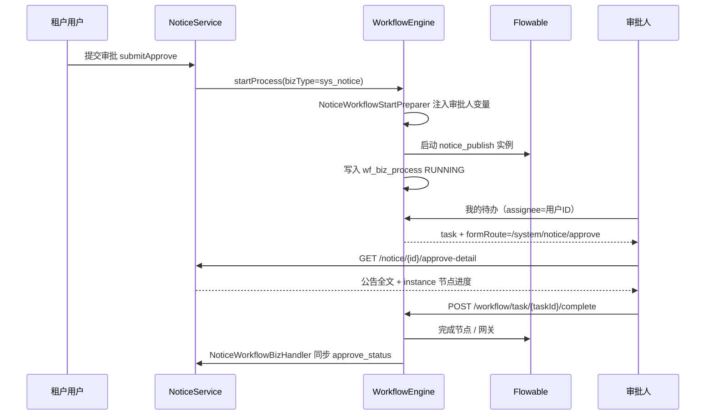

# 工作流配置与接入标准

> 面向：平台管理员、业务开发、架构评审  
> 配套：[ARCHITECTURE.md](./ARCHITECTURE.md)（模块边界） · [INTEGRATION.md](./INTEGRATION.md)（联调）

---

## 1. 三层模型（配置 / 引擎 / 业务）

严谨的工作流体系分三层，职责不可混：

```
┌──────────────────────────────────────────────────────────────────┐
│  L1 平台配置层（管理员可改，存库）                                  │
│  wf_model · wf_model_version · 字典 · 菜单 form_route             │
└────────────────────────────┬─────────────────────────────────────┘
                             │ 读取配置
┌────────────────────────────▼─────────────────────────────────────┐
│  L2 工作流引擎层（通用代码，零业务）                               │
│  启动/审批/撤回 · 待办/已办/轨迹 · AccessGuard · formRoute 解析    │
└────────────────────────────┬─────────────────────────────────────┘
                             │ SPI 回调
┌────────────────────────────▼─────────────────────────────────────┐
│  L3 业务接入层（每个 bizType 一次开发）                            │
│  BPMN · StartPreparer · BizHandler · approve-detail · 审批页业务区  │
└──────────────────────────────────────────────────────────────────┘
```

| 层 | 谁维护 | 变更是否需要发版 |
|----|--------|------------------|
| L1 | 平台管理员（流程模型页） | 改元数据/BPMN 部署：**否**（仅配置） |
| L2 | 平台框架组 | 发版 |
| L3 | 业务模块组 | 新 bizType：**是**（一次性接入） |

**结论：** 工作流「管理」主要是 L1；L3 是每个新业务类型的**一次性接入成本**，不是每个审批节点都要写代码。

---

## 2. 配置表说明（L1）

### 2.1 `wf_model` — 流程与业务的绑定注册表

| 字段 | 含义 | 配置方式 |
|------|------|----------|
| `model_key` | Flowable 流程定义 key（= BPMN `<process id>`） | 创建时固定 |
| `biz_type` | 业务类型（如 `sys_notice`） | 创建时固定，与业务表/字典一致 |
| `form_type` | `system` / `route` / `custom` | 模型页可改 |
| `form_route` | 待办「审批」跳转路径 | **模型页可改** → `WorkflowTaskVO.formRoute` |
| `tenant_id` | `0`=平台模板，全租户回落 | 创建时确定 |
| `status` | 启用/停用 | 模型页可改 |

**一条 `wf_model` = 一种业务的一种审批流程模板。**

### 2.2 `wf_model_version` — BPMN 版本

| 字段 | 含义 |
|------|------|
| `bpmn_xml` | 流程图定义 |
| `version_no` | 递增版本 |
| `published` | 当前生效版本 |

平台管理员在 **流程模型 → 部署** 粘贴/更新 BPMN；新发起的实例走新版本，运行中实例不受影响。

### 2.4 `wf_biz_binding_policy` — 平台级流程绑定策略

| 字段 | 含义 |
|------|------|
| `biz_type` | 业务类型（唯一） |
| `binding_mode` | `platform_mandatory`：强制平台流程；`tenant_preferred`：租户模型优先 |
| `allow_tenant_approver_override` | `platform_mandatory` 时，租户是否可覆盖 `wf_approver_rule` |

**公告示例：** `sys_notice` → `platform_mandatory`：租户不能创建自己的公告 BPMN，但可（可选）覆盖各节点审批人。

### 2.5 `wf_approver_rule` — 审批人规则

| 字段 | 含义 |
|------|------|
| `tenant_id` | `0`=平台默认；业务租户 ID=租户覆盖（仅审批人，不改 BPMN） |
| `model_id` | 关联 `wf_model` |
| `task_definition_key` | BPMN 用户任务节点 id |
| `variable_name` | 注入 Flowable 的变量名（与 BPMN `${var}` 一致） |
| `strategy_type` | `role` / `fixed_user` / `starter_dept_role` / `expression` |
| `strategy_config` | JSON，见下表 |
| `resolve_scope` | `biz_tenant` / `platform_tenant` |

**strategy_config 示例：**

| strategy_type | strategy_config |
|---------------|-----------------|
| `role` | `{"roleCodes":["dept_approver","tenant_admin"]}` |
| `fixed_user` | `{"userId":"2000000000000000002"}` |
| `starter_dept_role` | `{"roleCodes":["dept_approver"]}` — 发起人同部门内按角色解析 |
| `expression` | `{"expr":"starter"}` — Phase 1 仅支持发起人本人 |

启动时由 `WorkflowApproverRuleStartPreparer` 自动合并规则并注入变量，**业务模块无需再写审批人 preparer**。

### 2.6 租户流程模型管理

- 菜单：`WorkflowTenantModel`（`assign_scope=TENANT`），复用 `/workflow/model/index`
- 后端：`WorkflowTenantSupport.modelOwnerTenantId()` 自动隔离租户模型
- 租户仅可操作本租户 `wf_model`；`platform_mandatory` 的 `biz_type` 禁止租户创建模型
- 平台管理员仍用 `WorkflowModel`（`assign_scope=PLATFORM`）管理平台模板

### 2.7 跨租户三层（platform_mandatory 必读）

工作流同时存在 **操作者租户**、**业务租户**、**Flowable 租户**，不可混用。平台模板（`wf_model.tenant_id=0`）+ 租户业务数据时，平台审批人须跨租户读业务表并用 `WorkflowAccessGuard` 校验。

| 规范文档 | `docs/architecture/24-workflow-cross-tenant.md` |
| 统一组件 | `WorkflowCrossTenantSupport`、`AbstractWorkflowBizHandler` |
| 公告参考 | `NoticeServiceImpl#getApproveDetail`、`NoticeWorkflowBizHandler` |

---

## 3. 公告（notice）完整链路 — 帮助理解

公告是 **第一个 bizType 参考实现**，不是特殊通道。



| 步骤 | 配置还是代码 | 公告实现 |
|------|-------------|----------|
| 绑定 bizType↔流程 | **配置** `wf_model` | `notice_publish` + `sys_notice` |
| 待办跳哪个页 | **配置** `form_route` | `/system/notice/approve` |
| 流程有几级、谁审 | **BPMN** + **代码** preparer | 部门负责人→平台管理员 |
| 审批页看什么业务数据 | **代码** approve-detail | `NoticeApproveDetailVO` |
| 审批页布局/进度/提交 | **通用组件** | `WorkflowApproveLayout` + `complete` API |
| 通过后改业务状态 | **代码** BizHandler | `approve_status = approved` + `published_at` |

独立业务审批字段包与删/关规则见 [31-workflow-biz-menu.md](../../../docs/architecture/31-workflow-biz-menu.md) §2.1。

---

## 4. 后期其他业务：要手写审批页吗？能用代码生成器吗？

### 4.1 今天（Phase 1）的真实情况

| 页面/能力 | 生成方式 | 说明 |
|-----------|----------|------|
| 流程模型管理 | gen-spec + **已生成** | `workflow/model` |
| 我的待办/已办/**已发申请** | gen-spec + **已生成** | 已发申请 = 全 bizType 发起列表 |
| **业务审批页** | **手工**（有 spec 模板） | 复制 `noticeApprove` 改业务区 |
| 业务 CRUD 列表 | gen-spec 一键生成 | 与审批页独立 |

**代码生成器当前只支持 `standard-crud` / `tree-crud`。**  
审批页是 `layout: custom`，**不能一键 compile**，但有：

- gen-spec 草案：`gen-spec/drafts/system/noticeApprove/page-spec.yaml`（约定结构）
- 通用壳：`WorkflowApproveLayout` + `WorkflowProgressPanel`
- 业务区通常 **50~150 行 Vue**（简单表单型更少；富文本/附件型如公告更多）

### 4.2 每个新 bizType 最小接入包（L3，一次性）

| # | 交付物 | 必须？ |
|---|--------|--------|
| 1 | BPMN + `wf_model` 种子行 | 是 |
| 2 | `WorkflowStartPreparer` | 是（注入审批人等变量） |
| 3 | `WorkflowBizHandler` | 是（终态同步业务表） |
| 4 | 业务 `submitApprove` 调 `startProcess` | 是 |
| 5 | `GET /{resource}/{id}/approve-detail` | 是 |
| 6 | 审批 Vue 页（复用 Layout） | 是 |
| 7 | 隐藏菜单 + 权限 | 是 |
| 8 | `wf_biz_type` 字典项 | 是 |

**不需要：** 新做待办/已办/模型管理/complete API。

### 4.3 Phase 2 目标（更「配置化」）

| 能力 | 现状 | 目标 |
|------|------|------|
| 审批人 | preparer 硬编码角色 | `wf_approver_rule` 表 + 策略（角色/部门/表达式） |
| BPMN | 粘贴 XML | 可视化设计器 |
| 审批页 | 手工 Vue | 生成器支持 `layout: workflow-approve`，自动生成壳 + 字段区 |
| 简单业务详情 | 全自定义 | `form_type=system` 时按字段配置渲染只读表单 |

---

## 5. 标准工作流管理 — 管理员做什么

### 5.1 平台管理员（今天就能做）

1. **流程模型** `/workflow/model`
   - 查看平台模板（`tenant_id=0`）
   - 新建模型：填 `model_key`、`biz_type`、`form_route`
   - **部署 BPMN**：版本化，校验 `process id` = `model_key`
   - 启用/停用模型

2. **字典**
   - `wf_biz_type`：业务类型显示名
   - `wf_form_type`：表单类型
   - `wf_instance_status`、`wf_approve_action` 等

3. **权限/菜单**
   - 通用：`workflow:task:*`、`workflow:model:*`
   - 业务审批页：`workflow:approve:{biz}:view`（隐藏路由）

### 5.2 运行规范（引擎强制）

| 规则 | 实现 |
|------|------|
| 只有 assignee 能审批 | `WorkflowProcessServiceImpl.completeTask` |
| 只有发起人能撤回 | `WorkflowAccessGuard` |
| 已办不含未办理/撤回 | `WorkflowTaskServiceImpl` 过滤 |
| 待办必须配 formRoute | 无 fallback，前端提示配置 |
| 流程结束事件约定 | BPMN 结束节点 `endApproved` / `endRejected` |
| 业务回调 | 按 `bizType` 路由到 `WorkflowBizHandler` |

### 5.3 新库初始化（无需 V5）

全新库只跑 V1 + V2 + V3。公告相关已在 V2 种子中：

- `wf_model.form_route = '/system/notice/approve'`
- 菜单 `NoticeApprove` → `/system/notice/approve/index`
- BPMN bootstrap：`application.yml` → `processes/notice_publish.bpmn20.xml`（system 模块 classpath）

---

## 6. 推荐：新业务接入检查表

```markdown
## bizType: sys_xxx / model_key: xxx_approve

### 配置（L1）
- [ ] V2 或新 migration：`wf_model` 行（model_key, biz_type, form_route）
- [ ] 菜单：隐藏审批路由 + permission
- [ ] 字典：`wf_biz_type` 增加项
- [ ] application.yml：bootstrap classpath（若平台模板）

### 引擎（L2，通常不改）
- [ ] 确认 form_route 与 Vue 路径一致
- [ ] 确认 BPMN 结束节点 id 符合约定

### 业务（L3）
- [ ] BPMN 文件（业务模块 resources/processes/）
- [ ] WorkflowStartPreparer
- [ ] WorkflowBizHandler（**extends `AbstractWorkflowBizHandler`**）
- [ ] submitApprove / withdraw
- [ ] GET /.../approve-detail（**`WorkflowCrossTenantSupport`** + notice + instance + taskId）
- [ ] views/.../approve/index.vue（WorkflowApproveLayout）
- [ ] gen-spec/drafts/{module}/{page}Approve/page-spec.yaml

### 跨租户（L2，platform_mandatory 等）
- [ ] `startRequest.setTenantId` = 业务行 `tenant_id`；Flowable 用 `wf_model.tenant_id`
- [ ] 详见 `docs/architecture/24-workflow-cross-tenant.md`
```

---

## 7. 常见问题

**Q：每个业务都要做一个审批页面吗？**  
A：要有一个**业务详情展示页**（审批人看依据）。布局、进度、提交按钮是通用的；只有「左侧业务内容区」因业务而异。简单业务可很短，复杂业务（公告富文本）会长一些。

**Q：能不能全部代码生成？**  
A：列表/待办/模型管理已生成。审批页 Phase 1 用模板复制；Phase 2 计划生成器支持 `workflow-approve` 布局。

**Q：流程严谨性如何保证？**  
A：流程定义在 BPMN（版本化）；运行规则在引擎（权限/终态/已办过滤）；业务一致性在 BizHandler；绑定关系在 `wf_model`（禁止硬编码路由 fallback）。

**Q：租户能自定义流程吗？**  
A：Phase 1 仅平台模板（`tenant_id=0`）。Phase 2 开放租户 `wf_model` CRUD，同 `biz_type` 租户模型优先。

---

## 8. 相关文件索引

| 用途 | 路径 |
|------|------|
| 表结构 | `backend/database/schema/wf_tables.sql` |
| 公告 BPMN | `backend/icoolkj-admin-system/src/main/resources/processes/notice_publish.bpmn20.xml` |
| 公告 SPI | `backend/.../system/workflow/NoticeWorkflow*.java` |
| 公告审批页 | `frontend/src/views/system/notice/approve/index.vue` |
| 通用布局 | `frontend/src/components/workflow/WorkflowApproveLayout.vue` |
| 模型管理 UI | `frontend/src/views/workflow/model/index.vue` |
| 审批页 spec 模板 | `gen-spec/drafts/system/noticeApprove/page-spec.yaml` |
| 跨租户规范 | `docs/architecture/24-workflow-cross-tenant.md` |
